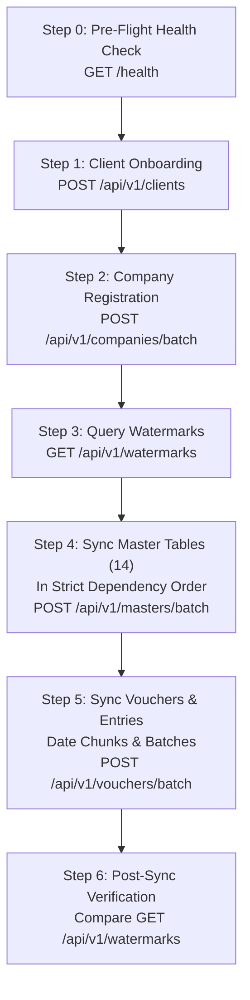
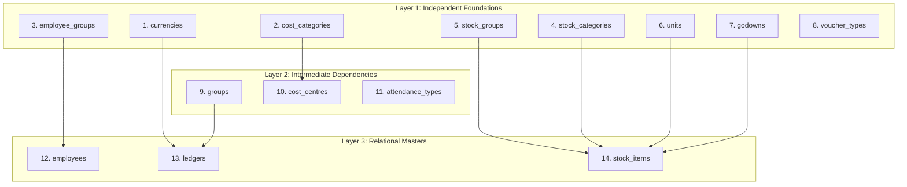

# Tally Replication API Specification & Client Implementation Guide

> **Target Audience:** AI Coding Assistants, Integration Engineers, and ETL Developers.  
> **Purpose:** Comprehensive, unambiguous, production-grade guide to implement client-side replication engines that extract data from Tally Prime / ERP 9 and synchronize it with the remote `backend_ETL` PostgreSQL service via REST APIs.

---

## 1. System Architecture & Replication Paradigm

### 1.1 Architecture Topology
```
┌───────────────────────────────────────────────┐
│              Client Environment               │
│  ┌────────────────┐       ┌────────────────┐  │
│  │  Tally Prime   │◄─────►│ Tally Worker   │  │
│  │ (XML/TDL HTTP) │       │ (Extractor)    │  │
│  └────────────────┘       └───────┬────────┘  │
└───────────────────────────────────┼───────────┘
                                    │ HTTPS REST
                                    │ (Bearer Token Auth)
┌───────────────────────────────────▼───────────┐
│            Backend Server (backend_ETL)       │
│  ┌─────────────────────────────────────────┐  │
│  │ FastAPI Service (CRUD & Batch APIs)     │  │
│  │ - 3-Way Match Multi-Tenant Security     │  │
│  │ - Atomic Voucher & Child Replacement    │  │
│  │ - Dynamic Watermark Aggregation         │  │
│  └────────────────────┬────────────────────┘  │
│                       │ Direct SQL (psycopg)  │
│  ┌────────────────────▼────────────────────┐  │
│  │ PostgreSQL 15+ Warehouse                │  │
│  │ - 20 Core Replicated Tables             │  │
│  │ - 3 Security & Access Mapping Tables    │  │
│  └─────────────────────────────────────────┘  │
└───────────────────────────────────────────────┘
```

### 1.2 Core Replication Principles
1. **Incremental Sync via Alter ID:** Every master record and voucher in Tally possesses an incrementing integer `alter_id`. Replicating systems poll the backend's highest known watermark (`max_alter_id`) and query Tally only for records modified since that watermark (`ALTERID > max_alter_id`).
2. **Idempotent Upserts:** All entity insertions use PostgreSQL `ON CONFLICT (guid) DO UPDATE SET ...`. Repeating any batch request is completely safe and produces identical state.
3. **Atomic Voucher Replacement:** Vouchers consist of a primary header (`vouchers`) and up to four child collections (`ledger_entries`, `inventory_entries`, `cost_centre_allocations`, `attendance_entries`). In the backend, a voucher upsert executes inside a single database transaction: the header is upserted, existing child rows are deleted for that `voucher_guid`, and new child rows are inserted.
4. **Static Query-Parameterized Routes:** In accordance with the `backend_ETL` design, all API routes use static URL paths and query parameters (e.g. `/api/v1/masters?client_id=...&company_id=...&table_name=...`) rather than path parameters.

---

## 2. Authentication, Authorization & The 3-Way Match Rule

Every API request (except the unauthenticated `GET /health` endpoint) is strictly guarded by the **3-Way Match Security Protocol**.

### 2.1 The 3-Way Match Enforcement
For any request scoped to a company, the backend verifies three distinct identity elements:
```
           ┌────────────────────────┐
           │ Authorization: Bearer  │
           │     <raw_token>        │
           └───────────┬────────────┘
                       │ SHA-256
                       ▼
               [ api_tokens ]
                       │
                       ▼ Token bound to
           ┌────────────────────────┐
           │ client_id (Query Param)│
           └───────────┬────────────┘
                       │
                       ▼ Must be mapped in [ client_companies ]
           ┌────────────────────────┐
           │company_id (Query Param)│
           └────────────────────────┘
```

1. **Bearer Token:** The HTTP header `Authorization: Bearer trs_<token_string>` is hashed using SHA-256 and matched against active records in `api_tokens`.
2. **Client Verification:** The `client_id` query parameter must match the `client_id` bound to that token in `api_tokens`, and the client must be active in the `clients` table.
3. **Company Access Isolation:** The `company_id` (or `guid`) query parameter must be mapped to the `client_id` in the `client_companies` junction table.

### 2.2 Token Lifecycle & Onboarding Modes
Tokens are created by an administrator using the backend CLI:
```bash
python -m backend_ETL.main --create-token [--client-id <optional_id>] [--description "<label>"]
```
- **Mode A (Pre-Assigned Token):** Admin passes `--client-id "acme_corp"`. The token is already bound to `"acme_corp"`. The client onboarding call (`POST /api/v1/clients?client_id=acme_corp`) activates this client.
- **Mode B (Unassigned Token):** Admin runs `--create-token` without `--client-id`. The token has `client_id = NULL`. When the client makes its first onboarding call (`POST /api/v1/clients?client_id=my_custom_id`), the backend **permanently binds** the token to that `client_id`.

### 2.3 HTTP Security Rejections
Violations trigger immediate `403 Forbidden` responses:

| Reason | HTTP Status | Response Detail |
| :--- | :--- | :--- |
| Missing or malformed `Authorization` header | `403` | `"Missing Authorization Bearer token"` or `"Invalid Authorization Bearer header format"` |
| Token not found or revoked (`is_active = 0`) | `403` | `"Forbidden: Invalid or inactive Bearer token"` |
| Token belongs to client A, but query has client B | `403` | `"Forbidden: Bearer token and client_id do not match"` |
| Client ID not registered via `POST /api/v1/clients` | `403` | `"Forbidden: Client must be created via POST /api/v1/clients first"` |
| Client has no access to the requested company | `403` | `"Forbidden: client_id does not have access to the specified company_id"` |
| Company GUID already owned by another client | `403` | `"Company GUID '<guid>' is already mapped to another client"` |

---

## 3. End-to-End Replication State Machine

To implement a complete client synchronizer, execute the following 6-step lifecycle:



### Step 0: Pre-Flight Health Check
- Call `GET /health` (no authorization header needed).
- Verify `{"status": "ok"}`. If `503`, the PostgreSQL database is unreachable. Wait and retry.

### Step 1: Client Onboarding & Token Binding
- Call `POST /api/v1/clients?client_id=<YOUR_CLIENT_ID>` with header `Authorization: Bearer <TOKEN>`.
- Payload: `{"client_name": "Acme Corp Ltd", "contact_email": "admin@acme.com"}`.
- If using an unassigned token, this binds the token to `<YOUR_CLIENT_ID>`.

### Step 2: Company Registration
- Read open companies from Tally Prime via TDL.
- Push company metadata to `POST /api/v1/companies/batch?client_id=<YOUR_CLIENT_ID>`.
- This creates the company record in `companies` and registers client ownership in `client_companies`.

### Step 3: Fetch Current Watermarks
- Call `GET /api/v1/watermarks?client_id=<YOUR_CLIENT_ID>&company_id=<COMPANY_GUID>`.
- Response provides `max_alter_id` and `row_count` for each table:
  ```json
  {
    "client_id": "acme_corp",
    "company_id": "c1f6b5a0-9c2b-4e89-b7e1-8899aabbccdd",
    "tables": {
      "currencies": {"row_count": 2, "max_master_id": 10, "max_alter_id": 150},
      "groups": {"row_count": 32, "max_master_id": 45, "max_alter_id": 420},
      "ledgers": {"row_count": 120, "max_master_id": 500, "max_alter_id": 1820},
      "vouchers": {"row_count": 1450, "max_master_id": 8200, "max_alter_id": 9500}
    }
  }
  ```

### Step 4: Replicate Master Tables in Dependency Order
Iterate through the 14 master tables in strict dependency order. For each table:
1. Identify `local_watermark = watermarks[table]["max_alter_id"]`.
2. Extract records from Tally where `ALTERID > local_watermark`.
3. Normalize records (GUIDs, strings, integers, decimals).
4. Send in batches of 500 rows to `POST /api/v1/masters/batch?client_id=...&company_id=...&table_name=<TABLE_NAME>`.

### Step 5: Replicate Vouchers (Transactions)
1. Identify `voucher_watermark = watermarks["vouchers"]["max_alter_id"]`.
2. Extract vouchers from Tally where `ALTERID > voucher_watermark`.
3. Separate each voucher into:
   - Header dictionary (`guid`, `date`, `voucher_type_name`, `narration`, etc.)
   - Child items: `ledger_entries`, `inventory_entries`, `cost_centre_allocations`, `attendance_entries` (each enriched with `voucher_guid = header["guid"]`).
4. Send in batches of 200–500 vouchers to `POST /api/v1/vouchers/batch?client_id=...&company_id=...`.

### Step 6: Post-Sync Verification
- Call `GET /api/v1/watermarks` again to confirm that `max_alter_id` matches the latest alter ID pulled from Tally.

---

## 4. Master Data Dependency Ordering (14 Tables)

When synchronizing master data, **strictly respect this execution sequence** to prevent foreign key or structural reference deadlocks:



| Order | Master Table Name | Foreign / Logical Dependencies | Description |
| :---: | :--- | :--- | :--- |
| **1** | `currencies` | None | Currencies & symbols |
| **2** | `cost_categories` | None | Cost categories for cost centre tagging |
| **3** | `employee_groups` | None | Employee department/group classifications |
| **4** | `stock_categories` | None | Inventory categories |
| **5** | `stock_groups` | None | Inventory groups hierarchy |
| **6** | `units` | None | Units of measurement (Simple & Compound) |
| **7** | `godowns` | None | Warehouses and storage locations |
| **8** | `voucher_types` | None | Voucher type definitions |
| **9** | `groups` | Self (parent group) | Account group hierarchy |
| **10** | `cost_centres` | `cost_categories` | Cost centres and departments |
| **11** | `attendance_types` | `units` | Payroll attendance and production types |
| **12** | `employees` | `employee_groups`, `cost_categories` | Employee profiles and bank details |
| **13** | `ledgers` | `groups`, `currencies` | Chart of accounts ledgers |
| **14** | `stock_items` | `stock_groups`, `stock_categories`, `units`, `godowns` | Products, inventory items |

---

## 5. Complete API Endpoint Reference

All endpoints return JSON. All error responses conform to `{"detail": "<error_message>"}`.

### 5.1 Service Health
#### `GET /health`
- **Authentication:** None.
- **Description:** Verifies service uptime and PostgreSQL database pool connectivity.
- **Response `200 OK`:**
  ```json
  {
    "status": "ok"
  }
  ```
- **Response `503 Service Unavailable`:**
  ```json
  {
    "detail": "Database unavailable: <connection_error_details>"
  }
  ```

---

### 5.2 Client Onboarding & Lookup
#### `POST /api/v1/clients`
- **Authentication:** `Authorization: Bearer <token>`
- **Query Parameters:**
  - `client_id` *(optional, string)*: Unique client identifier. If omitted and using an unassigned token, a UUID is automatically generated.
- **Request Body (`ClientCreateRequest`):**
  ```json
  {
    "client_name": "Acme Industrial Supplies",
    "contact_email": "finance@acme.com",
    "tally_version": "TallyPrime 4.1"
  }
  ```
- **Response `200 OK`:**
  ```json
  {
    "status": "ok",
    "data": {
      "client_id": "acme_industrial",
      "client_name": "Acme Industrial Supplies",
      "contact_email": "finance@acme.com",
      "tally_version": "TallyPrime 4.1",
      "is_active": 1
    }
  }
  ```

#### `GET /api/v1/clients`
- **Authentication:** `Authorization: Bearer <token>`
- **Query Parameters:**
  - `client_id` *(required, string)*: Client identifier.
- **Response `200 OK`:**
  ```json
  {
    "data": {
      "client_id": "acme_industrial",
      "client_name": "Acme Industrial Supplies",
      "contact_email": "finance@acme.com",
      "tally_version": "TallyPrime 4.1",
      "is_active": 1,
      "created_at": "2026-10-13T10:00:00+00:00",
      "updated_at": "2026-10-13T10:00:00+00:00",
      "company_guids": [
        "c1f6b5a0-9c2b-4e89-b7e1-8899aabbccdd"
      ]
    }
  }
  ```

---

### 5.3 Company Registration & Management
#### `POST /api/v1/companies/batch`
- **Authentication:** `Authorization: Bearer <token>`
- **Query Parameters:**
  - `client_id` *(required, string)*
- **Request Body (`CompanyBatchRequest`):**
  ```json
  {
    "rows": [
      {
        "guid": "c1f6b5a0-9c2b-4e89-b7e1-8899aabbccdd",
        "name": "Acme India Pvt Ltd",
        "books_from": "2024-04-01",
        "starting_from": "2024-04-01",
        "company_number": "10001",
        "ending_at": "2025-03-31",
        "gstin": "27AABCU9603R1ZX",
        "master_id": 1,
        "alter_id": 45,
        "synced_at": "2026-10-13T12:00:00Z"
      }
    ]
  }
  ```
- **Response `200 OK`:**
  ```json
  {
    "status": "ok",
    "upserted_count": 1
  }
  ```

#### `POST /api/v1/companies`
- **Authentication:** `Authorization: Bearer <token>`
- **Query Parameters:**
  - `client_id` *(required, string)*
- **Request Body (`CompanyPayload`):** Single company object.
- **Response `200 OK`:** `{"status": "ok", "upserted_count": 1, "guid": "..."}`

#### `GET /api/v1/companies`
- **Authentication:** `Authorization: Bearer <token>`
- **Query Parameters:**
  - `client_id` *(required, string)*
  - `guid` *(optional, string)*: Specific company GUID.
  - `name` *(optional, string)*: Specific company Name.
- **Response `200 OK` (Single):** `{"data": { ...company_fields }}`
- **Response `200 OK` (List):** `{"data": [ { ...company_fields }, ... ]}`

#### `PUT /api/v1/companies`
- **Authentication:** `Authorization: Bearer <token>`
- **Query Parameters:**
  - `client_id` *(required, string)*
  - `guid` *(required, string)*: Company GUID to update.
- **Request Body:** Partial or complete dictionary of fields to merge and update.
- **Response `200 OK`:** `{"status": "ok", "guid": "..."}`

#### `DELETE /api/v1/companies`
- **Authentication:** `Authorization: Bearer <token>`
- **Query Parameters:**
  - `client_id` *(required, string)*
  - `guid` *(required, string)*
- **Response `200 OK`:** `{"status": "ok", "deleted": true, "guid": "..."}`

---

### 5.4 Replication Watermarks
#### `GET /api/v1/watermarks`
- **Authentication:** `Authorization: Bearer <token>`
- **Query Parameters:**
  - `client_id` *(required, string)*
  - `company_id` *(required, string)*: Target company GUID.
- **Response `200 OK`:**
  ```json
  {
    "client_id": "acme_industrial",
    "company_id": "c1f6b5a0-9c2b-4e89-b7e1-8899aabbccdd",
    "tables": {
      "currencies": {
        "row_count": 1,
        "max_master_id": 1,
        "max_alter_id": 12
      },
      "groups": {
        "row_count": 34,
        "max_master_id": 50,
        "max_alter_id": 480
      },
      "cost_categories": { "row_count": 0, "max_master_id": 0, "max_alter_id": 0 },
      "cost_centres": { "row_count": 0, "max_master_id": 0, "max_alter_id": 0 },
      "employee_groups": { "row_count": 0, "max_master_id": 0, "max_alter_id": 0 },
      "employees": { "row_count": 0, "max_master_id": 0, "max_alter_id": 0 },
      "attendance_types": { "row_count": 0, "max_master_id": 0, "max_alter_id": 0 },
      "stock_categories": { "row_count": 5, "max_master_id": 20, "max_alter_id": 110 },
      "stock_groups": { "row_count": 12, "max_master_id": 40, "max_alter_id": 250 },
      "units": { "row_count": 4, "max_master_id": 15, "max_alter_id": 90 },
      "godowns": { "row_count": 3, "max_master_id": 8, "max_alter_id": 65 },
      "voucher_types": { "row_count": 18, "max_master_id": 35, "max_alter_id": 190 },
      "ledgers": { "row_count": 142, "max_master_id": 620, "max_alter_id": 3200 },
      "stock_items": { "row_count": 88, "max_master_id": 410, "max_alter_id": 2840 },
      "vouchers": { "row_count": 1250, "max_master_id": 9500, "max_alter_id": 14500 }
    }
  }
  ```

---

### 5.5 Master Tables Batch & CRUD (14 Tables)

Applies to all 14 table names: `currencies`, `groups`, `cost_categories`, `cost_centres`, `employee_groups`, `employees`, `attendance_types`, `stock_categories`, `stock_groups`, `units`, `godowns`, `voucher_types`, `ledgers`, `stock_items`.

#### `POST /api/v1/masters/batch`
- **Authentication:** `Authorization: Bearer <token>`
- **Query Parameters:**
  - `client_id` *(required, string)*
  - `company_id` *(required, string)*
  - `table_name` *(required, string)*: One of the 14 master table names.
- **Request Body (`MasterBatchRequest`):**
  ```json
  {
    "rows": [
      {
        "guid": "g-101",
        "name": "Sundry Debtors",
        "parent": "Current Assets",
        "primary_group": "Current Assets",
        "is_revenue": 0,
        "is_deemed_positive": 1,
        "master_id": 20,
        "alter_id": 105
      }
    ]
  }
  ```
- **Response `200 OK`:**
  ```json
  {
    "status": "ok",
    "table_name": "groups",
    "upserted_count": 1
  }
  ```
- **Error Responses:**
  - `400 Bad Request`: Invalid `table_name`.
  - `422 Unprocessable Entity`: Row missing required `guid` or `name`.

#### `GET /api/v1/masters`
- **Authentication:** `Authorization: Bearer <token>`
- **Query Parameters:**
  - `client_id` *(required, string)*
  - `company_id` *(required, string)*
  - `table_name` *(required, string)*
  - `guid` *(optional, string)*: Specific record GUID.
  - `min_alter_id` *(optional, integer, default: 0)*: Filter records where `alter_id >= min_alter_id`.
  - `limit` *(optional, integer, default: 500, max: 5000)*
  - `offset` *(optional, integer, default: 0)*
- **Response `200 OK` (List):**
  ```json
  {
    "data": [ { ...row_fields }, ... ],
    "count": 500
  }
  ```

#### `PUT /api/v1/masters`
- **Authentication:** `Authorization: Bearer <token>`
- **Query Parameters:**
  - `client_id` *(required, string)*
  - `company_id` *(required, string)*
  - `table_name` *(required, string)*
  - `guid` *(required, string)*: Record GUID to update.
- **Request Body:** Dictionary of fields to update.
- **Response `200 OK`:** `{"status": "ok", "table_name": "...", "guid": "..."}`

#### `DELETE /api/v1/masters`
- **Authentication:** `Authorization: Bearer <token>`
- **Query Parameters:**
  - `client_id` *(required, string)*
  - `company_id` *(required, string)*
  - `table_name` *(required, string)*
  - `guid` *(required, string)*
- **Response `200 OK`:** `{"status": "ok", "deleted": true, "table_name": "...", "guid": "..."}`

---

### 5.6 Vouchers & Child Entries (Atomic Transactions)

#### `POST /api/v1/vouchers/batch`
- **Authentication:** `Authorization: Bearer <token>`
- **Query Parameters:**
  - `client_id` *(required, string)*
  - `company_id` *(required, string)*
- **Description:** Atomically upserts voucher headers and replaces child rows across all 4 child tables.
- **Request Body (`VoucherBatchRequest`):**
  ```json
  {
    "headers": [
      {
        "guid": "v-9001",
        "date": "2024-05-10",
        "voucher_type_name": "Sales",
        "voucher_number": "INV-2024-001",
        "reference": "PO-9912",
        "party_ledger_name": "Alpha Corp Ltd",
        "narration": "Goods sold against PO",
        "is_cancelled": 0,
        "is_optional": 0,
        "is_invoice": 1,
        "place_of_supply": "Maharashtra",
        "party_gstin": "27AAACA1234A1Z5",
        "master_id": 1050,
        "alter_id": 4820
      }
    ],
    "ledger_entries": [
      {
        "voucher_guid": "v-9001",
        "ledger_name": "Alpha Corp Ltd",
        "amount": "11800.00",
        "is_deemed_positive": 1,
        "bill_ref": "INV-2024-001",
        "bill_type": "New Ref",
        "bill_amount": "11800.00"
      },
      {
        "voucher_guid": "v-9001",
        "ledger_name": "Sales Accounts",
        "amount": "-10000.00",
        "is_deemed_positive": 0
      },
      {
        "voucher_guid": "v-9001",
        "ledger_name": "Output IGST",
        "amount": "-1800.00",
        "is_deemed_positive": 0
      }
    ],
    "inventory_entries": [
      {
        "voucher_guid": "v-9001",
        "stock_item_name": "Industrial Widget A",
        "billed_qty": "10.00 Nos",
        "actual_qty": "10.00 Nos",
        "rate": "1000.00",
        "amount": "-10000.00",
        "godown_name": "Main Warehouse",
        "unit": "Nos"
      }
    ],
    "cost_centre_allocations": [
      {
        "voucher_guid": "v-9001",
        "ledger_name": "Sales Accounts",
        "cost_category": "Primary Cost Category",
        "cost_centre_name": "Western Sales Region",
        "amount": "10000.00",
        "is_deemed_positive": 0
      }
    ],
    "attendance_entries": []
  }
  ```
- **Response `200 OK`:**
  ```json
  {
    "status": "ok",
    "upserted_count": 1
  }
  ```

#### `GET /api/v1/vouchers`
- **Authentication:** `Authorization: Bearer <token>`
- **Query Parameters:**
  - `client_id` *(required, string)*
  - `company_id` *(required, string)*
  - `guid` *(optional, string)*: Specific voucher GUID. When provided, returns the complete voucher object including all child arrays (`ledger_entries`, `inventory_entries`, `cost_centre_allocations`, `attendance_entries`).
  - `from_date` *(optional, string, YYYY-MM-DD)*
  - `to_date` *(optional, string, YYYY-MM-DD)*
  - `voucher_type_name` *(optional, string)*
  - `min_alter_id` *(optional, integer, default: 0)*
  - `limit` *(optional, integer, default: 500)*
  - `offset` *(optional, integer, default: 0)*
- **Response `200 OK` (Single Voucher with Nested Entries):**
  ```json
  {
    "data": {
      "guid": "v-9001",
      "company_id": "c1f6b5a0-9c2b-4e89-b7e1-8899aabbccdd",
      "date": "2024-05-10",
      "voucher_type_name": "Sales",
      "voucher_number": "INV-2024-001",
      "ledger_entries": [ ... ],
      "inventory_entries": [ ... ],
      "cost_centre_allocations": [ ... ],
      "attendance_entries": [ ... ]
    }
  }
  ```

#### `DELETE /api/v1/vouchers`
- **Authentication:** `Authorization: Bearer <token>`
- **Query Parameters:**
  - `client_id` *(required, string)*
  - `company_id` *(required, string)*
  - `guid` *(required, string)*: Voucher GUID to delete. Deleting a voucher cascades to all child lines.
- **Response `200 OK`:** `{"status": "ok", "deleted": true, "guid": "..."}`

---

### 5.7 Direct Child Entry Maintenance
For fine-grained manipulation of line items without resending the entire voucher:

#### `GET /api/v1/voucher-entries`
- **Query Parameters:**
  - `client_id` *(required, string)*
  - `voucher_guid` *(required, string)*
  - `child_table` *(required, string)*: One of `ledger_entries`, `inventory_entries`, `cost_centre_allocations`, `attendance_entries`.
- **Response `200 OK`:** `{"data": [ ... ], "count": 3}`

#### `PUT /api/v1/voucher-entries`
- **Query Parameters:** `client_id`, `voucher_guid`, `child_table`
- **Request Body (`ChildEntriesBatchRequest`):** `{"rows": [ ...new_rows... ]}`
- **Response `200 OK`:** `{"status": "ok", "voucher_guid": "...", "child_table": "...", "replaced_count": 2}`

#### `DELETE /api/v1/voucher-entries`
- **Query Parameters:**
  - `client_id`, `voucher_guid`, `child_table`
  - `entry_id` *(optional, integer)*: Specific row ID. If omitted, deletes all child entries for this voucher.
- **Response `200 OK`:** `{"status": "ok", "deleted_count": 1}`

---

## 6. Table Schemas & Data Normalization Rules

### 6.1 Data Type Casting Rules
| Tally Field Type | PostgreSQL Column Type | Client Payload Format |
| :--- | :--- | :--- |
| **Dates** | `TEXT` | Format as ISO string: `"YYYY-MM-DD"` (e.g. `"2024-05-10"`) |
| **Amounts / Numbers** | `TEXT` | Always format as Decimal string (e.g. `"12500.50"`, `"-450.00"`). Avoid Python `float` roundoff errors. |
| **Booleans** | `INTEGER` | Send integer `0` (false) or `1` (true), or JSON boolean `true`/`false`. |
| **Identifiers / Alter ID** | `INTEGER` | Always positive integer (`0` if missing). |
| **Foreign Keys / Names** | `TEXT` | Stripped strings or `null`. |

---

### 6.2 Master Tables Column Reference (14 Tables)

#### 1. `currencies`
`guid` (PK), `company_id`, `name`, `mailing_name`, `original_name`, `expanded_symbol`, `decimal_symbol`, `decimal_places` *(int, default 2)*, `master_id` *(int)*, `alter_id` *(int)*, `synced_at`.

#### 2. `groups`
`guid` (PK), `company_id`, `name`, `parent`, `nature`, `primary_group`, `is_revenue` *(bool 0/1)*, `is_deemed_positive` *(bool 0/1)*, `affects_gross_profit` *(bool 0/1)*, `master_id` *(int)*, `alter_id` *(int)*, `synced_at`.

#### 3. `cost_categories`
`guid` (PK), `company_id`, `name`, `allocate_revenue` *(bool 0/1)*, `allocate_non_revenue` *(bool 0/1)*, `master_id` *(int)*, `alter_id` *(int)*, `synced_at`.

#### 4. `cost_centres`
`guid` (PK), `company_id`, `name`, `parent`, `category`, `revenue_le_for_op_bal` *(bool 0/1)*, `email_id`, `master_id` *(int)*, `alter_id` *(int)*, `synced_at`.

#### 5. `employee_groups`
`guid` (PK), `company_id`, `name`, `parent`, `category`, `master_id` *(int)*, `alter_id` *(int)*, `synced_at`.

#### 6. `employees`
`guid` (PK), `company_id`, `name`, `parent`, `category`, `employee_id`, `date_of_joining`, `deactivation_date`, `designation`, `function_role`, `location`, `gender`, `blood_group`, `pan_number`, `aadhar_number`, `pf_number`, `uan`, `esi_number`, `bank_name`, `bank_account_number`, `ifsc_code`, `email`, `mobile`, `master_id` *(int)*, `alter_id` *(int)*, `synced_at`.

#### 7. `attendance_types`
`guid` (PK), `company_id`, `name`, `parent`, `attendance_production_type`, `attendance_period`, `base_units`, `master_id` *(int)*, `alter_id` *(int)*, `synced_at`.

#### 8. `stock_categories`
`guid` (PK), `company_id`, `name`, `parent`, `master_id` *(int)*, `alter_id` *(int)*, `synced_at`.

#### 9. `stock_groups`
`guid` (PK), `company_id`, `name`, `parent`, `master_id` *(int)*, `alter_id` *(int)*, `synced_at`.

#### 10. `units`
`guid` (PK), `company_id`, `name`, `original_name`, `base_units`, `is_simple_unit` *(bool 0/1)*, `decimal_places` *(int)*, `conversion` *(string/decimal)*, `master_id` *(int)*, `alter_id` *(int)*, `synced_at`.

#### 11. `godowns`
`guid` (PK), `company_id`, `name`, `parent`, `address`, `has_no_space` *(bool 0/1)*, `has_no_stock` *(bool 0/1)*, `master_id` *(int)*, `alter_id` *(int)*, `synced_at`.

#### 12. `voucher_types`
`guid` (PK), `company_id`, `name`, `parent`, `numbering_method`, `is_active` *(bool 0/1)*, `affects_stock` *(bool 0/1)*, `prevent_duplicates` *(bool 0/1)*, `master_id` *(int)*, `alter_id` *(int)*, `synced_at`.

#### 13. `ledgers`
`guid` (PK), `company_id`, `name`, `parent`, `alias`, `mailing_name`, `address`, `state_name`, `country_name`, `pincode`, `pan_number`, `gstin`, `email`, `phone`, `mobile`, `credit_limit`, `credit_period`, `is_bill_wise_on` *(bool 0/1)*, `is_cost_centres_on` *(bool 0/1)*, `currency_name`, `opening_balance`, `closing_balance`, `gst_registration_type`, `tax_classification`, `master_id` *(int)*, `alter_id` *(int)*, `synced_at`.

#### 14. `stock_items`
`guid` (PK), `company_id`, `name`, `parent`, `category`, `base_units`, `alternate_units`, `hsn_code`, `gst_applicable`, `gst_type_of_supply`, `tax_rate`, `costing_method`, `valuation_method`, `opening_balance`, `opening_rate`, `opening_value`, `closing_balance`, `closing_value`, `master_id` *(int)*, `alter_id` *(int)*, `synced_at`.

---

### 6.3 Transaction Tables Column Reference

#### 15. `vouchers` (Header)
- Primary Key: `guid`
- Columns: `company_id`, `date`, `voucher_type_name`, `voucher_number`, `narration`, `reference`, `party_ledger_name`, `is_cancelled` *(bool 0/1)*, `is_optional` *(bool 0/1)*, `is_invoice` *(bool 0/1)*, `persisted_view`, `effective_date`, `reference_date`, `place_of_supply`, `party_gstin`, `consignee_name`, `irn`, `eway_bill_no`, `master_id` *(int)*, `alter_id` *(int)*, `synced_at`.

#### 16. `ledger_entries` (Child)
- Foreign Key: `voucher_guid` references `vouchers(guid)`
- Columns: `ledger_name`, `amount` *(decimal string)*, `is_deemed_positive` *(bool 0/1)*, `bill_ref`, `bill_type`, `bill_due_date`, `bill_credit_period`, `bill_amount` *(decimal string)*.

#### 17. `inventory_entries` (Child)
- Foreign Key: `voucher_guid` references `vouchers(guid)`
- Columns: `stock_item_name`, `billed_qty`, `actual_qty`, `rate`, `amount` *(decimal string)*, `godown_name`, `batch_name`, `unit`.

#### 18. `cost_centre_allocations` (Child)
- Foreign Key: `voucher_guid` references `vouchers(guid)`
- Columns: `ledger_name`, `cost_category`, `cost_centre_name`, `amount` *(decimal string)*, `is_deemed_positive` *(bool 0/1)*.

#### 19. `attendance_entries` (Child)
- Foreign Key: `voucher_guid` references `vouchers(guid)`
- Columns: `employee_name`, `attendance_type`, `value` *(decimal string)*, `time_value`.

---

## 7. Error Handling, Rate Limiting & Retry Blueprint

### 7.1 Response Status Code Matrix
| HTTP Status | Interpretation | Client Action |
| :---: | :--- | :--- |
| `200 OK` | Request succeeded. | Proceed to next batch or phase. |
| `400 Bad Request` | Invalid query parameter (e.g. unknown table name). | Fix parameter in code; **do not retry**. |
| `403 Forbidden` | 3-Way match failure, bad token, or unmapped company. | Halt sync; trigger authentication alert. |
| `404 Not Found` | Entity not found on single get/update/delete. | Log missing record. |
| `422 Unproc. Entity` | Payload validation failure (e.g. missing `guid`). | Log offending row schema; **do not retry**. |
| `500 Server Error` | Unhandled backend exception. | Retry with exponential backoff. |
| `503 Unavailable` | Database pool exhausted or PostgreSQL service down. | Retry with exponential backoff. |

### 7.2 Exponential Backoff Algorithm
For network timeouts, connection resets, and HTTP 500/503 responses, apply exponential backoff with full jitter:

$$t_{\text{sleep}} = \min(t_{\text{max}},\, t_{\text{base}} \times 2^{\text{attempt}}) \times (0.5 + 0.5 \times \text{random}())$$

- $t_{\text{base}} = 1.0\text{s}$
- $t_{\text{max}} = 30.0\text{s}$
- Max Retries = $5$

---

## 8. Reference Python Replication Client Implementation

Below is a complete, production-grade Python client class implementing this specification. An AI assistant or developer can embed this directly into the replication worker:

```python
"""Reference client for Tally remote PostgreSQL ETL replication."""

from __future__ import annotations

import logging
import random
import time
from typing import Any

import requests
from requests.adapters import HTTPAdapter
from urllib3.util.retry import Retry

log = logging.getLogger(__name__)


class TallyReplicationApiClient:
    """Production client for synchronizing Tally data with the backend_ETL API."""

    def __init__(
        self,
        base_url: str,
        bearer_token: str,
        client_id: str,
        timeout_seconds: float = 60.0,
        max_retries: int = 5,
    ) -> None:
        self.base_url = base_url.rstrip("/")
        self.bearer_token = bearer_token.strip()
        self.client_id = client_id.strip()
        self.timeout = timeout_seconds
        self.max_retries = max_retries

        self._session = requests.Session()
        self._session.headers.update(
            {
                "Authorization": f"Bearer {self.bearer_token}",
                "Content-Type": "application/json",
                "Accept": "application/json",
            }
        )

        # Standard retry adapter for network-level dropouts
        retry_strategy = Retry(
            total=max_retries,
            backoff_factor=1.0,
            status_forcelist=[500, 502, 503, 504],
            allowed_methods=["GET", "POST", "PUT", "DELETE"],
            raise_on_status=False,
        )
        adapter = HTTPAdapter(max_retries=retry_strategy, pool_connections=10, pool_maxsize=20)
        self._session.mount("http://", adapter)
        self._session.mount("https://", adapter)

    def _request(
        self,
        method: str,
        path: str,
        params: dict[str, Any] | None = None,
        json_data: Any = None,
    ) -> dict[str, Any]:
        """Executes HTTP request with jittered backoff on transient failures."""
        url = f"{self.base_url}{path}"
        effective_params = params.copy() if params else {}

        attempt = 0
        while True:
            try:
                resp = self._session.request(
                    method=method,
                    url=url,
                    params=effective_params,
                    json=json_data,
                    timeout=self.timeout,
                )
                if resp.status_code == 200:
                    return resp.json()

                # Handle permanent authorization / validation errors
                if resp.status_code in (400, 403, 404, 422):
                    detail = resp.json().get("detail", resp.text)
                    log.error("API %d on %s %s: %s", resp.status_code, method, path, detail)
                    raise requests.HTTPError(
                        f"HTTP {resp.status_code} on {method} {path}: {detail}",
                        response=resp,
                    )

                # Retry on 5xx errors
                resp.raise_for_status()

            except (requests.ConnectionError, requests.Timeout, requests.HTTPError) as exc:
                attempt += 1
                if attempt > self.max_retries:
                    log.critical("Max retries exceeded for %s %s: %s", method, path, exc)
                    raise

                sleep_time = min(30.0, (1.0 * (2 ** (attempt - 1)))) * (0.5 + 0.5 * random.random())
                log.warning(
                    "Request %s %s failed (%s). Retrying in %.2fs (attempt %d/%d)...",
                    method,
                    path,
                    exc,
                    sleep_time,
                    attempt,
                    self.max_retries,
                )
                time.sleep(sleep_time)

    # ─── Step 0: Health ──────────────────────────────────────────────────────────

    def check_health(self) -> bool:
        """Checks if remote backend ETL service and database are operational."""
        url = f"{self.base_url}/health"
        resp = requests.get(url, timeout=10.0)
        return bool(resp.status_code == 200 and resp.json().get("status") == "ok")

    # ─── Step 1: Client Onboarding ───────────────────────────────────────────────

    def register_or_verify_client(
        self, client_name: str, contact_email: str | None = None, tally_version: str | None = None
    ) -> dict[str, Any]:
        """Onboards or binds this client ID to the backend token."""
        return self._request(
            method="POST",
            path="/api/v1/clients",
            params={"client_id": self.client_id},
            json_data={
                "client_name": client_name,
                "contact_email": contact_email,
                "tally_version": tally_version,
            },
        )

    def get_client_info(self) -> dict[str, Any]:
        """Retrieves registered client profile and associated company GUIDs."""
        return self._request(
            method="GET",
            path="/api/v1/clients",
            params={"client_id": self.client_id},
        )

    # ─── Step 2: Company Registration ───────────────────────────────────────────

    def register_companies(self, companies: list[dict[str, Any]]) -> int:
        """Registers and maps one or more companies to this client."""
        result = self._request(
            method="POST",
            path="/api/v1/companies/batch",
            params={"client_id": self.client_id},
            json_data={"rows": companies},
        )
        return int(result.get("upserted_count", 0))

    # ─── Step 3: Watermarks ──────────────────────────────────────────────────────

    def get_watermarks(self, company_id: str) -> dict[str, dict[str, int]]:
        """Retrieves row counts and max alter_id watermarks for all company tables."""
        res = self._request(
            method="GET",
            path="/api/v1/watermarks",
            params={"client_id": self.client_id, "company_id": company_id},
        )
        return res.get("tables", {})

    # ─── Step 4: Masters Synchronization ─────────────────────────────────────────

    def push_masters_batch(
        self,
        company_id: str,
        table_name: str,
        rows: list[dict[str, Any]],
    ) -> int:
        """Bulk upserts records into one of the 14 master tables."""
        if not rows:
            return 0
        res = self._request(
            method="POST",
            path="/api/v1/masters/batch",
            params={
                "client_id": self.client_id,
                "company_id": company_id,
                "table_name": table_name,
            },
            json_data={"rows": rows},
        )
        return int(res.get("upserted_count", 0))

    # ─── Step 5: Vouchers Synchronization ───────────────────────────────────────

    def push_vouchers_batch(
        self,
        company_id: str,
        headers: list[dict[str, Any]],
        ledger_entries: list[dict[str, Any]],
        inventory_entries: list[dict[str, Any]],
        cost_centre_allocations: list[dict[str, Any]],
        attendance_entries: list[dict[str, Any]],
    ) -> int:
        """Atomically upserts voucher headers and replaces their child entry collections."""
        if not headers:
            return 0
        payload = {
            "headers": headers,
            "ledger_entries": ledger_entries,
            "inventory_entries": inventory_entries,
            "cost_centre_allocations": cost_centre_allocations,
            "attendance_entries": attendance_entries,
        }
        res = self._request(
            method="POST",
            path="/api/v1/vouchers/batch",
            params={"client_id": self.client_id, "company_id": company_id},
            json_data=payload,
        )
        return int(res.get("upserted_count", 0))
```

---

## 9. Replication Orchestrator Execution Flow

An AI implementer should connect local Tally extraction with the above API client using this reference orchestration loop:

```python
"""Example orchestration pipeline showing how to execute the 6-phase replication."""

import logging
from TallyReplicationApiClient import TallyReplicationApiClient

MASTER_TABLES_ORDER = [
    "currencies",
    "cost_categories",
    "employee_groups",
    "stock_categories",
    "stock_groups",
    "units",
    "godowns",
    "voucher_types",
    "groups",
    "cost_centres",
    "attendance_types",
    "employees",
    "ledgers",
    "stock_items",
]


def run_replication_cycle(
    client: TallyReplicationApiClient,
    company_guid: str,
    company_metadata: dict,
    tally_extractor: Any,
) -> None:
    # Phase 0: Pre-flight Health Check
    if not client.check_health():
        raise RuntimeError("Replication backend database is unavailable.")

    # Phase 1: Onboard Client
    client.register_or_verify_client(client_name="My Company Name")

    # Phase 2: Register Company
    client.register_companies([company_metadata])

    # Phase 3: Query Watermarks
    watermarks = client.get_watermarks(company_id=company_guid)

    # Phase 4: Master Sync in Dependency Order
    for table_name in MASTER_TABLES_ORDER:
        table_info = watermarks.get(table_name, {})
        current_alter_id = table_info.get("max_alter_id", 0)

        # Pull modified master records from local Tally where ALTERID > current_alter_id
        records = tally_extractor.fetch_masters(table_name, min_alter_id=current_alter_id)
        if records:
            # Send in batches of 500
            for i in range(0, len(records), 500):
                batch = records[i : i + 500]
                client.push_masters_batch(company_guid, table_name, batch)

    # Phase 5: Transaction Voucher Sync
    voucher_info = watermarks.get("vouchers", {})
    voucher_alter_id = voucher_info.get("max_alter_id", 0)

    # Extract vouchers from local Tally where ALTERID > voucher_alter_id
    bundle = tally_extractor.fetch_vouchers(min_alter_id=voucher_alter_id)
    if bundle["headers"]:
        for i in range(0, len(bundle["headers"]), 200):
            h_slice = bundle["headers"][i : i + 200]
            guids = {h["guid"] for h in h_slice}

            le_slice = [r for r in bundle["ledger_entries"] if r["voucher_guid"] in guids]
            ie_slice = [r for r in bundle["inventory_entries"] if r["voucher_guid"] in guids]
            cca_slice = [r for r in bundle["cost_centre_allocations"] if r["voucher_guid"] in guids]
            ae_slice = [r for r in bundle["attendance_entries"] if r["voucher_guid"] in guids]

            client.push_vouchers_batch(
                company_id=company_guid,
                headers=h_slice,
                ledger_entries=le_slice,
                inventory_entries=ie_slice,
                cost_centre_allocations=cca_slice,
                attendance_entries=ae_slice,
            )

    logging.info("Replication cycle completed successfully.")
```

---

## 10. Verification & Checklist

Before deploying any replication code against `backend_ETL`, verify the following:

- [ ] **Bearer Token Set:** `Authorization: Bearer <token>` is present on all calls except `/health`.
- [ ] **Client Registered:** `POST /api/v1/clients` was called before registering companies or masters.
- [ ] **Company Mapped:** `POST /api/v1/companies/batch` was executed so the company GUID is bound to `client_id` in `client_companies`.
- [ ] **3-Way Match Uniformity:** `client_id` and `company_id` query parameters match on all entity endpoints.
- [ ] **Dependency Order Respected:** Master tables are sent in the designated 14-table order.
- [ ] **Voucher Child Integrity:** All child entries (`ledger_entries`, `inventory_entries`, `cost_centre_allocations`, `attendance_entries`) contain a valid `voucher_guid` matching a header in the same or existing batch.
- [ ] **Amounts Formatted as Strings:** Monetary values are formatted as decimal strings (e.g. `"1500.00"`) to avoid floating-point drift.
- [ ] **Backoff Configured:** Exponential backoff with jitter handles network reconnects and HTTP 500/503 errors gracefully.
